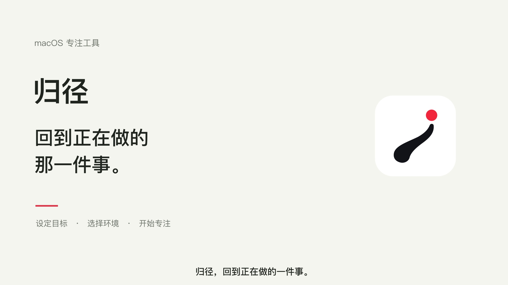

# 归径

> 回到正在做的一件事。

归径是一款 macOS 桌面专注应用。写下这次想推进的目标，选好时长与工作应用，再配上自然场景和声音，为写作、阅读、编程或日常办公留出一段专注时间。

## 产品介绍视频

77 秒了解归径的基本功能，观看从设定目标、选择应用与场景，到开始、暂停、继续和结束专注的实际演示。

## 核心功能

### 围绕一个目标开始

每次专注从一个具体目标出发，例如「写完方案第一版」。支持 **1–180 分钟**的自定义时长，可拖动滑块、直接输入，或选择 5、15、30、60 分钟的常用刻度。

### 减少应用切换带来的分心

选择本次需要使用的应用，支持搜索已安装应用，也可从其他位置添加。专注时，归径会尝试收起范围外的普通应用，让它们保留在后台运行；Finder 和必要的系统交互不拦截。

临时需要其他应用时，可在范围外应用提示中选择「加入本次」。放行会保留到本次专注结束，不改动已保存的模版。

### 按需开启沉浸模式

在「设置 → 专注设置」开启沉浸模式后，归径会在具有辅助功能权限时，尽力将所选工作窗口切入 macOS 原生全屏。

缺少权限、窗口不支持全屏或切换失败时，仍可正常开始和继续计时。暂停或结束时，仅尝试还原能确认由本轮专注造成的全屏和收起效果；原本已全屏的窗口保持原状。

### 选择自然场景与声音

内置 **高山、雪山、草原、森林、池塘、花园**六种自然场景，可预览入场短片，并选择是否显示自然背景。

- **背景音乐**：随场景搭配，可独立开关和调节音量。
- **自然声音**：提供下雨、鸟叫、海浪、流水，可自动随场景搭配或手动选择，音量与音乐分开调整。
- **入场与提醒**：入场短片、人声引导和到点提示音分别设置；支持预听和声音组合试听。

场景媒体随应用保存在本机，离线也可使用。关闭自然背景时会跳过入场短片；偏好安静工作时，也可以关闭各项声音。

### 随时掌握进度

工作时，屏幕右上角显示透明计时，不阻挡鼠标操作。到点后给出短暂提示，并继续记录超出计划的时间。

通过菜单栏或 Dock 返回控制界面，可暂停、继续或结束专注。关闭窗口后会话仍在继续；暂停后恢复不重播入场短片。

### 用模版复用工作习惯

将常用的时长、应用范围、场景和声音配置保存为模版。下次可载入后调整，也可直接开始已保存的模版；直接开始时使用模版名称作为目标。

常用模版可固定到菜单栏，空闲时单击即可开始。本次配置的临时调整不会自动覆盖模版，需要明确保存才会更新。

### 查看投入统计与历史

在「统计」中查看今天、近 7 天、近 30 天或自定义日期范围的专注投入。历史记录支持按目标名称搜索、按日期筛选、查看详情，以及复用过去的目标。

需要整理记录时，可删除历史，并在本次打开应用期间撤销删除。

## 开始一次专注

1. 在「专注」页写下目标，设置时长。
2. 添加本次需要使用的应用，选择自然场景。
3. 按需在「设置 → 专注设置」调整声音、入场和沉浸模式，查看当前保护范围后开始。
4. 工作中通过菜单栏或 Dock 暂停、继续或结束；结束后到「统计」查看投入和记录。

常用配置可另存为模版，方便下一次开始。

## 本地数据与个人偏好

专注记录、模版和偏好保存在本机，默认数据目录为 `~/Library/Application Support/Zhuanzhuli`。归径不读取工作文档内容。

应用提供浅色与深色外观。遇到问题时，可自行开启调试日志，按级别查看并导出当前筛选的记录；日志仅保存在本机，可能包含所选应用的标识。

## 系统要求与当前状态

- **系统**：macOS 15 及以上，支持 Apple 芯片与 Intel Mac。
- **使用**：安装后的应用无需另行安装 Go 或 Python。
- **权限**：沉浸全屏需要辅助功能权限，可在专注设置中打开系统权限页面并重新检查；未授权仍可计时。
- **当前阶段**：开发试用中，尚未完成完整产品验收。
- **通知边界**：系统专注模式联动属于实验能力，通知效果仍待验证。系统通知和声音仍可能出现；关键警报、部分系统／来电和应用自绘提醒不在覆盖范围内。

