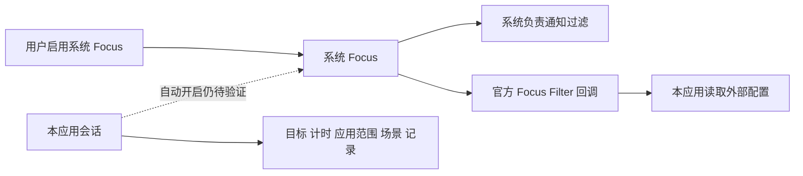

# macOS 系统专注模式：可复用能力与产品接入建议

调研日期：2026-10-23。目标环境为本机 macOS 15.6；接口声明另核对 Xcode 26.2 SDK。系统较新版本的搜索结果不直接作为本机行为依据。本轮只调研，没有修改应用代码、系统配置或已有产品范围，也没有把此前的 Esc 候选方案视为获准。

后续实机执行另记于 [系统 Focus 与过滤条件验证](系统Focus与过滤条件验证.md)：独立样例构建、系统发现和默认配置读取已通过；原生通知效果及系统开／关回调仍未验证。以下“本轮”指本调研阶段，不覆盖后续执行。

## 结论

值得复用系统 Focus 的通知过滤能力，并借鉴其菜单栏入口、配置与日常操作分离、明确状态和例外的交互。应用继续负责目标、计时、工作应用范围、场景和记录。

需要区分三个层面：系统本身具备能力、第三方应用有公开接入接口、当前实现已有实机验收。这三者不能互相替代。**本轮核对的公开接口没有提供通用的“按名称创建／开启／关闭系统 Focus，并取得可恢复所有权”的能力。**这是一项基于当前接口的调查结论，不是对所有系统版本和内部实现的断言。

最有价值的新接入方向是 Focus Filters：系统先改变 Focus，再把配置送给应用。它可以减少对控制中心读状态的依赖，但不能直接替代“从本应用一键开始，同时开启系统 Focus”。后者仍是现有需求缺口，不改成手动流程或反向启动流程来宣称完成。

## 系统能力与本产品的分工

| 系统已有能力 | 可复用或借鉴的方式 | 不能据此推断 |
|---|---|---|
| 按模式管理联系人、应用、即时通知和来电例外 | 使用用户专门配置的系统 Focus 承担标准通知策略 | 存在系统模式不代表本应用能公开编程切换它，也不代表所有提醒均被屏蔽 |
| 控制中心／菜单栏显示开关状态及临时持续时间 | 借鉴轻入口、状态可见、设置独立的交互 | 系统“持续一小时”不能替代本产品到点后由用户决定继续的会话时钟 |
| 时间、位置、应用触发的定时 | 作为系统提供的可选能力了解 | 应用触发会在切到其他应用时关闭，不适合跨应用办公会话 |
| 跨设备共享 | 展示其影响，尊重用户已有设置 | 本应用的 macOS 操作不一定只影响这台 Mac |
| 各应用自己的 Focus 过滤条件 | 接入系统到应用的配置联动 | 它不提供其他应用的窗口管理和本产品范围外三选能力 |

系统能力依据：[Apple：macOS 15 设置专注模式](https://support.apple.com/zh-cn/guide/mac-help/mchl613dc43f/15.0/mac/15.0)、[打开或关闭专注模式](https://support.apple.com/en-gb/guide/mac-help/mchl999b7c1a/15.0/mac/15.0)。上表对本产品的分工和适配取舍为设计推论。

标准通知仍有边界：即时通知可由用户允许突破 Focus，关键警报存在突破能力。不同通知等级由系统区别处理，不等于关闭系统总音量。[Apple：通知设计与 Focus](https://developer.apple.com/design/human-interface-guidelines/managing-notifications)、[即时通知](https://developer.apple.com/documentation/usernotifications/unnotificationinterruptionlevel/timesensitive)。继续沿用用户已接受的标准通知范围与明确例外。

## 公开接口逐项核查

### Focus Filters：适合正式接入的系统到应用通道

`SetFocusFilterIntent` 用于在 Focus 改变后调整应用自身配置。Apple 示例中，开启已配置的 Focus 后系统调用 `perform()` 并提供参数；关闭后会提供默认参数。`current` 读取本应用的当前过滤配置，而不是枚举或选择系统模式。[Focus Filters 总览](https://developer.apple.com/documentation/appintents/focus/)、[定义应用过滤条件](https://developer.apple.com/documentation/appintents/defining-your-app-s-focus-filter)、[current](https://developer.apple.com/documentation/appintents/setfocusfilterintent/current)。

`FocusFilterAppContext.notificationFilterPredicate` 过滤的是**本应用自己的通知**，不是对其他应用的全局规则；`invalidateFocusFilterAppContext()` 是让系统重新读取本应用上下文，也不是开启 Focus。[FocusFilterAppContext](https://developer.apple.com/documentation/appintents/focusfilterappcontext)、[刷新上下文](https://developer.apple.com/documentation/appintents/setfocusfilterintent/invalidatefocusfilterappcontext())。

对本产品的建议：把它作为外部系统配置来源，与既有 Go 会话状态分开。回调不自动新建会话、不判断任务完成，也不覆盖用户手动暂停；通知保护丢失时沿用已确认的受限／暂停和主动恢复规则。是否映射场景或偏好属于后续设计选择，当前不增加功能。

### Focus Status：不能作为完整系统开关检测

`INFocusStatusCenter` 提供授权和状态读取；本机 SDK 的 `focusStatus`、`authorizationStatus` 均为只读。`INFocusStatus.isFocused` 是可空布尔值，没有模式名称、配置列表或用于恢复的版本凭据。[状态中心](https://developer.apple.com/documentation/intents/infocusstatuscenter)、[Focus 状态](https://developer.apple.com/documentation/intents/infocusstatus)。

**特别需要纠正“false 就是系统 Focus 已关闭”的假设。**Apple 的通信通知示例说明：当启用的 Focus 允许当前应用通知时，该应用看到的状态可能不是 focused；未授权时还可能没有值。该示例的状态读取和变化处理也有通知授权、Focus 状态授权及 Communication Notifications capability 等前提。它面向通信场景，不能未经验证就作为普通专注工具的通用检测方案。[Apple：通信通知与 Focus 状态示例](https://developer.apple.com/documentation/usernotifications/handling-communication-notifications-and-focus-status-updates)。

因此，不应由一个 `isFocused` 值宣称“指定专用模式已开”“所有标准通知已屏蔽”或“这个模式仍由本应用拥有”。

### UserNotifications：管理本应用通知

`UNUserNotificationCenter` 用于本应用／扩展的授权、发送、读取设置和清理通知；不是其他应用通知的系统总开关。[Apple：UNUserNotificationCenter](https://developer.apple.com/documentation/usernotifications/unusernotificationcenter)。本产品到点提醒继续遵守既有温柔提醒约定，不因为接入 Focus 而擅自提高提醒等级。

### AX 操作控制中心：操作系统界面，不是复用 Focus 编程接口

当前生产实现读取实际控制中心结构并执行暴露动作。它使用公开 Accessibility API，但目标界面结构、展开时序和面板关闭不是稳定的 Focus 业务协议。换成原生 Go／Swift 语言本身不会消除这些依赖。

现有记录 105 真实确认 AX=true、模式列表可读、勿扰模式 off；面板自动关闭仍失败，`capabilityVerified=false`。先前代理通过 CUA 发送 Esc 清理，只证明代理的清理动作有效。当前恢复仍没有可识别同模式外部关闭再开启（ABA）的系统所有权凭据；增加 Esc 并不解决这个问题。

## 建议的产品与工程方向

以下是调研后的建议，不是已确认的范围变更或已实现能力。

1. **复用通知策略，保留产品主体。**应用选择与收起、范围外选择、暂停／恢复、目标计时、入场和记录继续由本应用承担。工作应用名单和系统通知例外是两个概念，不自动互相转换，也不提前加入二期通知白名单。
2. **借鉴原生交互，保留既有风格。**工作期间以菜单栏状态和紧凑窗口为主，复杂配置留在系统／应用设置。清楚区分会话已暂停、系统通知状态未知、通知联动未配置，避免用一个绿色状态概括全部能力。
3. **将系统 Focus 当作外部状态。**用户、系统定时和其他设备均可能改变它。保留其更改；不能因为应用会话继续就无条件重新开启或在结束时强行关闭系统模式。
4. **优先验证官方回调，不把它包装成全局开关。**Focus Filters 可以形成正式的反向接入路径；是否把它作为产品启动入口，需要另行确认。当前的一键开始要求继续保留为未满足项。

工程代价判断：SDK 将 `SetFocusFilterIntent` 声明为 Swift 协议，macOS 13 起可用；现有构建只编译 Go，没有 App Intents 元数据／Swift 目标。基于此，接入预计需要小型 Swift App Intents 目标或扩展，以及与 Go 的受控状态交接。Apple 示例使用扩展并通过 App Groups 或自定义服务共享数据。**具体宿主形式、发现机制、签名、共享数据与打包须先用独立样例验证，当前不能承诺仅增加一处 purego 调用即可完成。**不因此决定重写主界面。[Apple 示例与结构](https://developer.apple.com/documentation/appintents/defining-your-app-s-focus-filter)。

## 后续最小验证顺序

| 顺序 | 要回答的问题 | 通过证据 |
|---|---|---|
| 1 | 不依赖本应用自动化时，配置好的系统 Focus 能否抑制自有夹具标准通知 | 先有关闭时可见／可听基线，再比较开启与关闭；提醒和声音设置 enabled 不代替效果 |
| 2 | 本机 15.6 能否发现小型 Focus Filter 接入目标 | 系统设置可添加该过滤条件，开启／关闭真实收到参数与默认值 |
| 3 | 回调能否安全交给 Go | 重复／延迟／应用未运行时不新建两个会话、不清除用户暂停、不写坏数据 |
| 4 | 若仍要求应用发起自动开关，如何满足当前约束 | 明确选择独立的触发方案；验证面板关闭、外部更改、锁屏和恢复，不能用回调成功代替 |

本轮没有执行这些新样例或更改系统 Focus，也没有新增权限。官方资料说明的能力、工程推论和本项目已通过的实机证据在文中分别列明；原有 R06／AC5 仍未通过。

## 资料与核对方式

优先使用 Apple macOS 15 手册、Apple 开发文档、WWDC22 [Meet Focus filters](https://developer.apple.com/videos/play/wwdc2022/10121/) 和本机 SDK 声明。Context7 用于读取官方 App Intents 文档。agent-reach 的 Exa 未配置、Jina 请求超时，后续使用官方站点检索，没有把无法访问作为接口不存在的证据。未进行私有框架调用或系统配置逆向写入。

本地核对位置：Xcode SDK 的 `Intents.framework/Headers/INFocusStatusCenter.h`、`INFocusStatus.h`，以及 `AppIntents.framework/Modules/AppIntents.swiftmodule/arm64e-apple-macos.swiftinterface` 中的 `SetFocusFilterIntent`／`FocusFilterAppContext`。SDK 可用性声明不等于本机运行验收。
